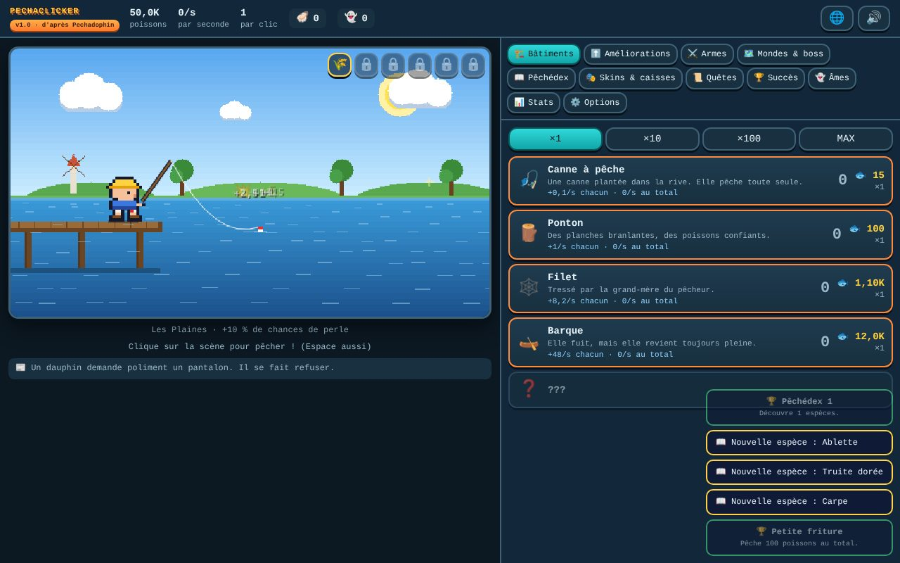
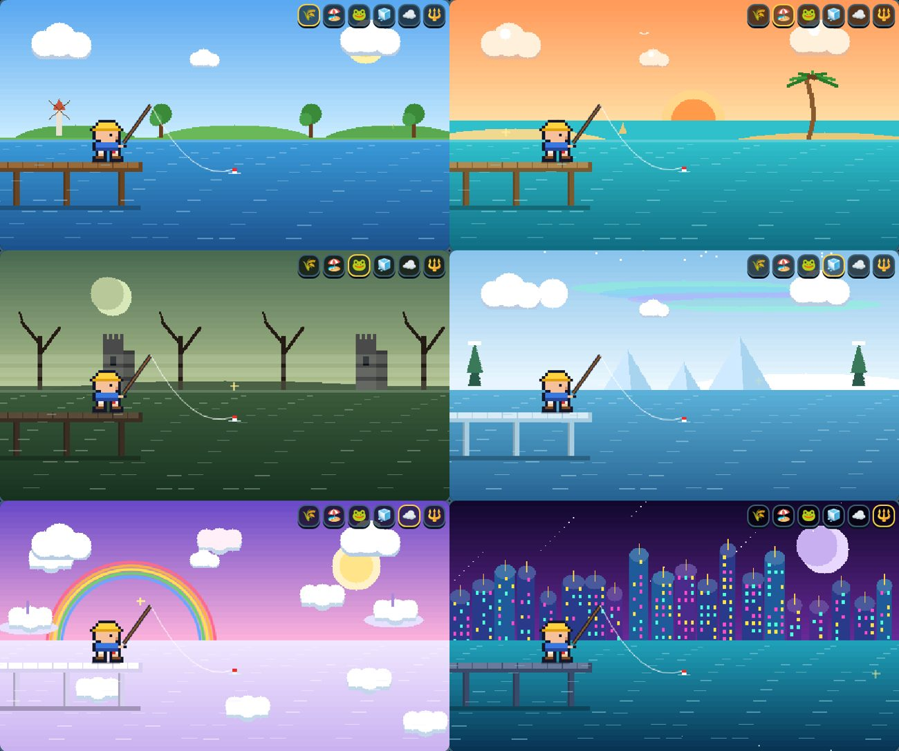
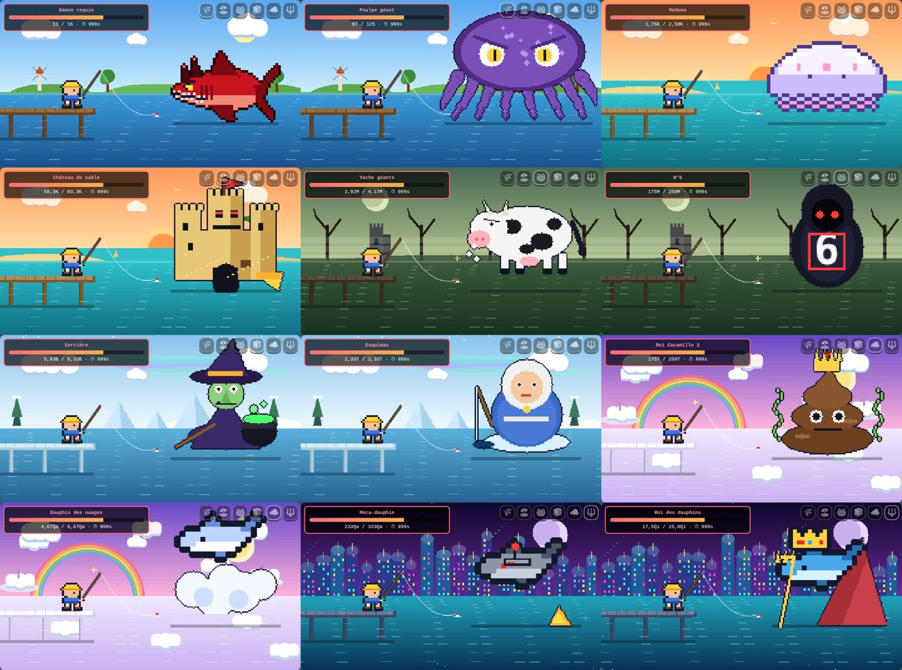
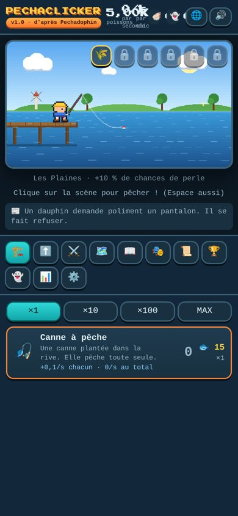

<div align="center">

# 🎣 Pechaclicker

### Le clicker pixel art du pêcheur sans pantalon

Inspiré de [**Pechadophin**](https://pechadophin.vercel.app/) · Cookie Clicker · Clicker Heroes · un soupçon de Pokédex

**6 mondes · 12 boss · 12 armes · 36 poissons · 37 skins · 176 succès · prestige · FR/EN**

</div>



## ▶️ Jouer

Ouvre `index.html` dans un navigateur — aucune installation, aucun build, aucune dépendance.
(Sur GitHub Pages : *Settings → Pages → Deploy from branch → `main` / root*.)

## 🎮 Comment jouer

- **Clique** sur la scène (ou `Espace`) : le pêcheur lance sa ligne et ramène un poisson. Chaque espèce a sa rareté.
- Dépense tes poissons en **12 bâtiments** (canne, ponton, filet, barque, cormoran dressé, chalutier, appât magique, cabane, port, sous-marin, phare, cité engloutie) qui pêchent pour toi.
- Achète des **améliorations** (126) : doublement par bâtiment à 1/5/25/50/100/150/200 exemplaires, bonus globaux, critiques, événements, hors-ligne…
- Clique les **événements** qui passent : banc de poissons (×7), pluie de poissons (clics ×77), marée haute, coffres, bouteilles à la mer… et les 10 morceaux du **pantalon perdu**.
- Cherche les **scintillements** dans chaque décor : un trésor caché par monde (les 6 débloquent le skin Clown).



## 🌍 Contenu

| | |
|---|---|
| **6 mondes** | Plaines · Plage · Marécages · Glacière · Monde Nuage · Cité des dauphins — chacun avec son décor animé, son dauphin, son bonus et son trésor caché |
| **12 boss** (+ mode Anarchie sans fin) | Démon requin, Poulpe géant, Méduse, Château de sable, Vache géante, N°6, Sorcière, Esquimau, Roi Cacamille 2, Dauphin des nuages, Méca-dauphin, Roi des dauphins |
| **12 armes** | Canne, Trident infernal, Dagues, Arme Numéro 6, Sceptre de glace, Jeu de tarot, Harpon, Katana, Boomerang, Tentacules, Faux, Trident royal — niveaux 1 à 10, chacune avec un pouvoir (critiques, double prise, combos, dégâts de boss, perles…) |
| **Pêchédex** | 36 espèces (6 par monde, 5 raretés) ; 25 prises = +1 % de production, monde complet = +5 % |
| **Caisses & skins** | Caisse Héros / Vilain à ouvrir avec des 🦪 perles (×1 ×2 ×4, roulette animée), les **vrais skins de Pechadophin** (32 en caisse, 6 fragments chacun, plus rares = plus chers) + 4 skins à mériter (Clown, Épouvofodille, RNG∞, Dino). Chaque skin donne un bonus de production |
| **Quêtes** | 3 quêtes actives en permanence, générées selon ta progression |
| **176 succès** | +0,5 % de production chacun |
| **Prestige** | La *Renaissance* te donne des **âmes rouges** (+3 % de production chacune) à dépenser dans une boutique de 14 bonus permanents |
| **Stats** | Graphique du débit au fil du temps (avec infobulle et vue tableau) et part de production par bâtiment |
| **Hors-ligne** | Les bâtiments continuent de pêcher (jusqu'à 8 h) |



### Combats de boss

Quand tu as pêché assez de poissons dans le run, tu peux **affronter** le boss suivant : 60 secondes, tes clics (critiques compris) + 30 % de ton débit lui font des dégâts. Aucune pénalité en cas d'échec — reviens plus fort. Vaincre le 2ᵉ boss d'un monde ouvre le suivant.

## 🎨 Direction artistique

Reprise de **Pechadophin** : les sprites (pêcheur 16×16 et ses skins, dauphins bleu/rose/rouge et leurs variantes glace, requin, méduse, poulpe, coffre, perle, couronne…) sont **les vrais sprites du jeu**, importés tels quels (`js/pd.js`, moteur `spr()` à grille de caractères + palettes + contour sombre automatique). Les textes de l'intro, des chapitres et des boss viennent aussi du jeu. Le reste (décors animés, autres boss, poissons) est dessiné dans le même esprit : pixels nets, contours sombres, nuages doux, thème bleu-ardoise, boutons biseautés, police *Press Start 2P*.

## 🔊 Sons

22 sons réels de [**SoundWeaver**](https://github.com/) (licence MIT) intégrés en base64, joués via `HTMLAudioElement` (aucune synthèse). Volume et mode muet dans l'en-tête et dans *Options*.

## 🛠️ Sous le capot

```
index.html        page
style.css         thème
js/data.js        toutes les données (bâtiments, mondes, boss, poissons, armes, skins, améliorations…)
js/logic.js       logique pure, sans DOM : économie, achats, boss, événements, prestige, caisses, succès, sauvegarde
js/pd.js          sprites réels de Pechadophin (skins, dauphins, requin, poulpe, méduse, objets)
js/art.js         décors animés, 36 poissons, boss restants + scène
js/ui.js          interface (onglets, modales, graphiques SVG)
js/sfx.js         lecteur de sons ; js/sounds.js = WAV en base64
js/main.js        boucle de jeu, entrées, sauvegarde automatique
test/sim.js       simulation d'un joueur glouton (équilibrage de l'économie)
test/smoke.js     test navigateur Playwright : tous les onglets, mondes, boss, caisses, 0 erreur console
test/flow.js      test navigateur : sauvegarde, langue, renaissance, sauvegarde corrompue, mobile
```

- Sauvegarde automatique (`localStorage`, clé `pechaclicker.save`) toutes les 20 s, export/import par code.
- Tester : `node test/sim.js` · `NODE_PATH=$(npm root -g) node test/smoke.js` · `NODE_PATH=$(npm root -g) node test/flow.js`.
- Les sprites passent par des fonctions (`fishSprite`, `bossSprite`, `skinSprite`…) faciles à remplacer par de vrais PNG.



## 📜 Crédits

Univers, sprites, skins et textes : [Pechadophin](https://github.com/FireTalesHy/Pechadophin) par L'taleshy & cocobat. Sons : SoundWeaver (MIT).
